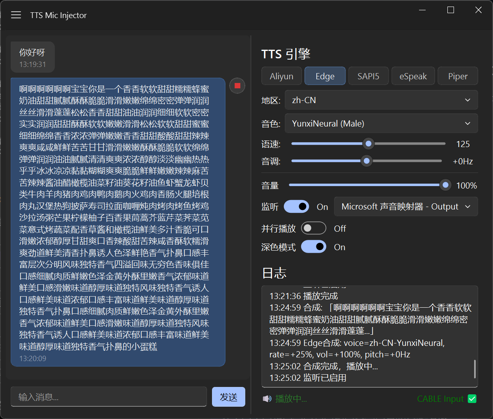

# TTS Mic Injector

将任意文字通过 TTS 合成后注入虚拟麦克风，在微信、QQ、钉钉等 VoIP 通话中使用。

> **适用场景**：语音通话中只能打字回应、游戏开黑不想开麦、语言障碍辅助等。



## 功能

| 功能 | 说明 |
|------|------|
| 💬 聊天式操作 | 左侧聊天气泡面板，消息可点击重放，播放中高亮 |
| 🎙️ 语音注入 | 合成后的音频输出到 VB-Cable 虚拟麦克风 |
| 🔊 实时监听 | 同时在扬声器播放，确认合成效果 |
| ⚡ 全局快捷键 | ESC 停止播放，Enter 发送，Ctrl+Enter 保存音频 |
| 📝 消息历史 | 所有消息保留在聊天列表，点击即可重放 |
| 🔀 并行播放 | 可选允许多条消息同时播放 |
| 🌗 深色模式 | 启动跟随系统主题，手动切换实时生效 |
| 🔧 一键安装 | 点击不可用引擎时弹出安装向导，自动 pip install / 下载外部程序 |
| 📡 远程输入 | 通过 WebSocket 中继服务器远程发送文本 |

## 支持的 TTS 引擎

| 引擎 | 类型 | 音色数 | 语速调节 | 需要额外安装 |
|------|------|--------|----------|-------------|
| **SAPI5** | Windows 本地 | 系统安装的语音 | ✅ | 内置（无需额外安装） |
| **Aliyun** | 阿里云 Qwen TTS | 40+ | ❌ | dashscope + API Key |
| **Edge** | 微软云端 (免费) | 数百种 | ✅ | edge-tts, ffmpeg |
| **eSpeak** | 本地开源 | 1 (中文) | ✅ | espeak-ng.exe |
| **Piper** | 本地神经网络 | 取决于 .onnx 模型 | ✅ | piper.exe + 模型 |

> 点击不满足依赖的引擎会弹出安装向导，自动 pip install 或下载可执行文件到 `tools/` 目录。Aliyun 还可在弹窗中直接填写 API Key 保存到配置文件。

## 安装

### 方式一：预编译版本（推荐）

前往 [Releases]() 下载最新版可执行文件，解压即用。

### 方式二：从源码运行

#### 1. 安装 VB-Cable 虚拟声卡

首次启动应用时会**自动弹窗引导安装**，无需手动操作。

也可手动从 [vb-audio.com/Cable](https://vb-audio.com/Cable/) 下载安装，然后在系统声音设置中将「CABLE Input」设为默认通信设备。

#### 2. 安装 Python 依赖

```bash
pip install -r requirements.txt
```

核心依赖会自动安装以下包：

| 包 | 用途 |
|----|------|
| `PyQt5` | GUI 框架 |
| `PyQt-Fluent-Widgets` | Fluent Design 组件库 |
| `pyaudio` | 音频设备操作（仅 Windows） |
| `pywin32` | Windows COM（SAPI5 引擎，仅 Windows） |

其他引擎依赖（edge-tts、dashscope、websocket-client）在点击对应引擎时会弹出安装向导一键安装。

#### 3. 安装外部程序（按需）

| 引擎 | 需要 | 下载地址 |
|------|------|---------|
| eSpeak NG | `espeak-ng.exe` | [github.com/espeak-ng/espeak-ng/releases](https://github.com/espeak-ng/espeak-ng/releases) |
| Piper | `piper.exe` + 模型 | [github.com/rhasspy/piper/releases](https://github.com/rhasspy/piper/releases) |
| Piper 模型 | `.onnx` 文件 | [huggingface.co/rhasspy/piper-voices](https://huggingface.co/rhasspy/piper-voices) |
| ffmpeg | `ffmpeg.exe` | [ffmpeg.org/download.html](https://ffmpeg.org/download.html) |

将可执行文件放入 `tools/` 目录或系统 PATH，`.onnx` 模型放入 `piper_models/`。也可点击引擎按钮通过弹窗自动下载到 `tools/`。

## 配置

编辑项目根目录的 `config.json`：

```json
{
    "aliyun": {
        "api_key": "sk-你的密钥",
        "model": "qwen3-tts-flash-realtime",
        "voice": "Ethan"
    },
    "paths": {
        "espeak": "espeak-ng.exe",
        "piper": "piper.exe",
        "piper_models": "piper_models",
        "ffmpeg": "ffmpeg"
    }
}
```

完整配置项见 [config.json](config.json)。所有字段均有硬编码默认值，缺失时自动回退。

## 远程输入

通过 WebSocket 中继服务器，将远程设备（手机、平板等）发送的文字转发到本机 TTS，实现远程语音播报。

### 工作流程

```
远程设备 --HTTP POST--> 中继服务器 --WebSocket--> 本机 TTS Mic Injector
```

### 1. 部署中继服务器

在公网服务器上运行 `server.py`：

```bash
pip install aiohttp
REMOTE_TOKEN=your-32-char-random-token python server.py
# 默认监听 8765 端口
```

也可设置 `PORT` 环境变量指定端口。

### 2. 配置客户端

在右侧面板中打开"远程输入"开关，点击"配置"填写：

| 配置项 | 说明 |
|--------|------|
| 地址:端口 | 中继服务器地址，如 `your-server.com:8765` |
| Token | 与服务端 `REMOTE_TOKEN` 一致 |

或直接编辑 `config.json`：

```json
{
    "remote": {
        "enabled": true,
        "server_url": "ws://your-server.com:8765/ws",
        "token": "your-32-char-random-token"
    }
}
```

### 3. 发送消息

向中继服务器发 HTTP POST 请求：

```bash
curl -X POST "http://your-server.com:8765/api/send?token=your-token" \
  -H "Content-Type: application/json" \
  -d '{"text": "你好，这是远程发送的文字"}'
```

消息自动出现在聊天列表并触发 TTS 播放。单条消息最长 500 字，每个 IP 每分钟限 30 条。

## 运行

```bash
python app.py
```

## 项目结构

```
├── app.py                  # 入口 (PyQt5 + Fluent Design)
├── config.json             # 用户配置
├── config.py               # 配置加载中心（默认值 + 合并）
├── requirements.txt        # Python 依赖清单
├── server.py               # WebSocket 中继服务器（部署到公网）
├── app/                    # UI 层 (PyQt5 + qfluentwidgets)
│   ├── main_window.py      # 主窗口，QSplitter 可拖拽双栏布局
│   ├── chat_widget.py      # 左侧聊天气泡面板
│   ├── message_item.py     # 聊天气泡组件
│   ├── settings_panel.py   # 右侧控制面板
│   ├── setup_popup.py      # 引擎依赖一键安装弹窗
│   ├── remote_receiver.py  # 远程 WebSocket 消息接收
│   ├── log_bridge.py       # 日志 → UI 桥接
│   └── utils/              # QConfig、日志、主题工具
├── service/
│   └── tts_service.py      # TTS 核心编排层
├── engines/                # 5 个 TTS 引擎
│   ├── base.py             # TTSEngine 抽象基类
│   ├── __init__.py         # 引擎工厂 create_engine()
│   ├── aliyun.py           # 阿里云 Qwen TTS
│   ├── edge.py             # Microsoft Edge TTS
│   ├── sapi5.py            # Windows SAPI5（异步初始化）
│   ├── espeak.py           # eSpeak NG
│   └── piper.py            # Piper 神经网络
├── audio/
│   ├── __init__.py         # 按平台选后端（Windows: pyaudio / 其他: pacat）
│   ├── device.py           # AudioDevice —— 两端共用的设备值对象
│   ├── pcm.py              # 降混 / 音量（两端共用纯函数）
│   ├── player.py           # Windows: PyAudio 播放（VB-Cable + 监听双输出）
│   └── linux_audio.py      # Linux: pacat 播放（PipeWire 虚拟麦克风 + 监听双输出）
├── platforms/
│   └── linux/              # PipeWire drop-in + install.sh + launch.sh + 图标
├── installer/
│   └── vbcable_installer.py # VB-Cable 一键安装器（下载/安装/检测）
├── tools/                  # 外部可执行文件存放目录
├── ui/                     # 旧版 Tkinter UI（已废弃）
├── assets/
│   ├── icons/
│   └── qss/
└── tests/                  # 单元测试
```

## 打包为 exe

```bash
python build_qt.py
```

## 依赖

详见 [requirements.txt](requirements.txt)。

| 包 | 用途 |
|----|------|
| `PyQt5` | GUI 框架 |
| `PyQt-Fluent-Widgets` | Fluent Design 组件库 |
| `pyaudio` | 音频设备操作（仅 Windows） |
| `pywin32` | Windows COM（SAPI5 引擎，仅 Windows） |
| `edge-tts` | Microsoft Edge TTS（可选，一键安装） |
| `dashscope` | 阿里云 TTS（可选，一键安装） |
| `websocket-client` | 远程输入（可选，一键安装） |

## Linux（Fedora / PipeWire）

Linux 上没有 VB-Cable，虚拟麦克风改用 **PipeWire 的 loopback** 实现，播放走 `pacat`。
Windows 侧行为完全不变（`audio/player.py` 仍走 pyaudio + VB-Cable）。

### 一键安装

```bash
git clone https://github.com/Triangle-GitHub/tts-mic-injector && cd tts-mic-injector
bash platforms/linux/install.sh          # 幂等；只写用户级文件，不需要 sudo
bash platforms/linux/install.sh --check  # 只体检
bash platforms/linux/install.sh --uninstall
```

它做四件事：

| 装什么 | 装到哪 |
|---|---|
| 虚拟麦克风 drop-in（`platforms/linux/51-tts-mic.conf`） | `~/.config/pipewire/pipewire.conf.d/51-tts-mic.conf` |
| venv（`PyQt5` / `PyQt-Fluent-Widgets` / `edge-tts`） | `<repo>/.venv` |
| 启动器（指向 `platforms/linux/launch.sh`） | `~/.local/libexec/tts-mic-injector` |
| 桌面入口 + 图标 | `~/.local/share/applications/tts-mic-injector.desktop`、`~/.local/share/icons/…` |

装完后：应用菜单里打开「TTS 虚拟麦克风」，然后在目标程序（浏览器 / Discord /
Element / OBS）里把麦克风选成 **TTS Mic**。

判据：

```bash
pactl list short sources | grep ttsmic_src        # 虚拟麦克风 source 在
bash platforms/linux/install.sh --check           # 六项体检
```

### 虚拟麦克风是怎么搭的

一条常驻 null sink + 一条 loopback：

```
应用 → ttsmic_out (Audio/Sink) → monitor → loopback → ttsmic_src (Audio/Source) → 通话软件
```

关键是 `capture.props` 里的 **`stream.capture.sink = true`**：没有它，capture 流不会去
抓目标 sink 的 monitor，设备建得出来、`pactl` 也看得见，但 `ttsmic_src` 上一条 link
都没有，录回来是静音。

没有那份 drop-in 配置时，程序会退化成现场 `pactl load-module`（`module-null-sink` +
`module-remap-source`）造一对——能跑，但显示名会被 pipewire 的 modargs 截断成 `TTS`。

### 依赖

- 系统包：`pulseaudio-utils`（`pactl` / `pacat`）、`espeak-ng`（Fedora 默认已装）、
  可选 `ffmpeg`（Edge 引擎转码要用）
- pip：`PyQt5`、`PyQt-Fluent-Widgets`；`pyaudio` / `pywin32` 在 Linux 上**不需要**
  （`requirements.txt` 已按平台标记）

### 引擎差异

| 引擎 | Linux |
|---|---|
| eSpeak | ✅ **默认**，直接调用系统 `espeak-ng`（离线） |
| Edge / Aliyun | ✅ 云端，跨平台 |
| Piper | ⚠️ 一键安装会下 Linux 版二进制（tar.gz，自动解包 + 给执行位）；`.onnx` 模型仍需自己选 |
| SAPI5 | ❌ Windows 专属，Linux 上引擎按钮直接不显示 |

### 代码结构（为什么这里是跨平台的）

```
audio/
├── __init__.py        # 唯一一处按平台选择后端，并导出平台无关的小工具
├── device.py          # AudioDevice(id, label, is_virtual) —— 两端共用的设备值对象
├── pcm.py             # 降混 / 逐 chunk 音量，两端共用的纯函数
├── player.py          # Windows: pyaudio + VB-Cable
└── linux_audio.py     # Linux: pacat + PipeWire 虚拟麦克风
```

两个后端暴露同一套接口（`find_virtual_mic()` / `list_output_devices()` /
`play(..., monitor_device=...)` / `stop()`），`service/` 及以上**没有任何平台判断**。
设备标识在 Windows 上是整数下标、在 Linux 上是 sink 名，统一由 `AudioDevice` 包住，
所以不存在「枚举顺序变了、下标漂了」的问题。

### 已知坑

- **别用 `paplay`**：实测 `paplay` 对着 pipewire-pulse 播出来是静音的（同一个 WAV
  文件，`pacat` peak 12000 / `paplay` peak 341）。播放一律走 `pacat` 流式 PCM——
  这也顺带保住了「逐 chunk 调音量」和「ESC 立即停止」。
- 监听设备列表会排除虚拟麦克风自身，避免把麦克风再喂回麦克风。
- 重启 `pipewire`/`pipewire-pulse`/`wireplumber` 会让 drop-in 生效，会打断正在播放的
  声音几秒；`install.sh` 只在配置有变化时才重启。

## License

MIT
